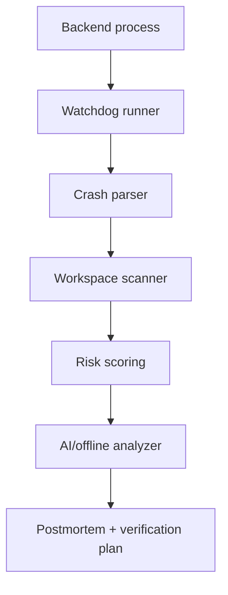

# Overwatch

AI-assisted incident triage for backend services.

Overwatch watches a local backend process, captures crash context, analyzes likely root cause, estimates blast radius, and generates a postmortem with verification and rollback guidance.

[Demo video](https://www.loom.com/share/d726800595724e46b06b40906cbdce6f)


## Why This Exists

Backend incidents are rarely blocked by typing speed. They are blocked by context recovery:

- What failed first?
- Which stack frame matters?
- What files and configs are related?
- Is retry safe?
- What is the likely blast radius?
- What should be verified before a fix is trusted?

Overwatch automates the first-pass triage workflow while keeping code changes human-approved.

## What It Does

- Runs a target backend process under a watchdog
- Captures stdout, stderr, exit codes, timestamps, and crash metadata
- Parses stack traces and classifies failure scenarios
- Scans nearby workspace files for relevant source context
- Scores severity, blast radius, retry safety, regression risk, and confidence
- Builds an AI-ready incident prompt for Cursor or another local agent command
- Falls back to deterministic offline analysis when no AI provider is configured
- Generates a durable `POST_MORTEM.md` with root cause, patch proposal, rollback plan, and verification steps

## Architecture



## Tech Stack

TypeScript · Node.js · Express · Docker · Cursor-compatible agent commands · Local deterministic fallback

## Quickstart

```bash
git clone https://github.com/Build4mBottom/overwatch.git
cd overwatch
npm install
cp .env.example .env
npm run demo:offline
```

Run the live watchdog demo:

```bash
npm run start:watchdog
```

Try a specific failure scenario:

```bash
SCENARIO=api-contract npm run start:watchdog
```

Supported demo scenarios include malformed JSON, async promise failures, invalid environment configuration, API contract errors, dependency resolution, database connection failures, timeouts, worker crashes, memory pressure, event-loop starvation, and retry storms.

## Safety Model

Overwatch is read-only by default.

- It observes and analyzes failures.
- It proposes remediation steps.
- It does not automatically modify production code.
- Human review remains the final approval point.

## Repository Structure

```text
src/
  runner.ts                 # process watchdog
  crash_parser.ts           # stack trace and failure parsing
  workspace_scanner.ts      # local context recovery
  severity_classifier.ts    # severity classification
  blast_radius.ts           # impact estimation
  retry_safety.ts           # retry/rollback guidance
  agent.ts                  # AI/offline analysis path
  postmortem_generator.ts   # incident report generation
examples/
docs/
```

## What This Demonstrates

- Backend failure analysis
- Runtime-aware developer tooling
- AI-assisted operational workflows
- Safe automation boundaries
- TypeScript service design
- Incident documentation and verification discipline

## Status

Prototype/demo project. Built to demonstrate incident-triage architecture and developer-tooling product thinking.

## License

MIT
